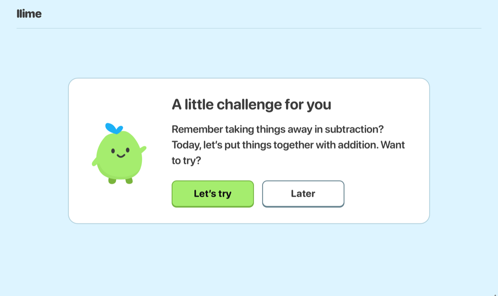
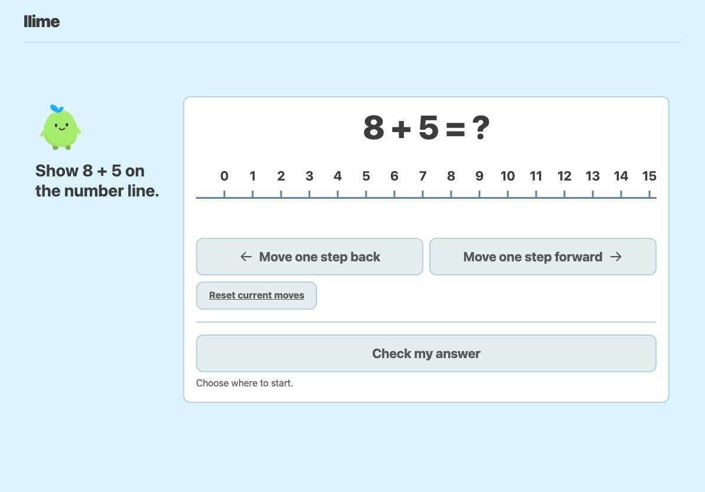
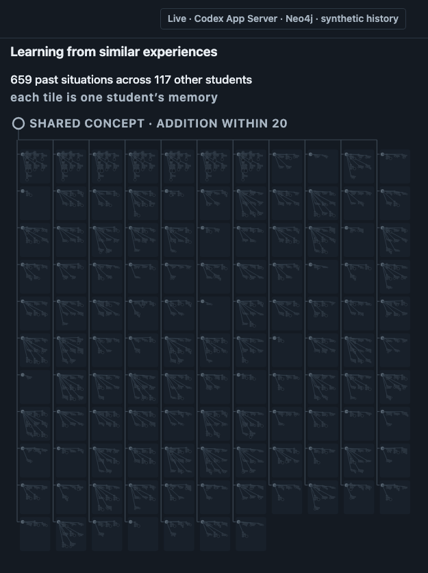
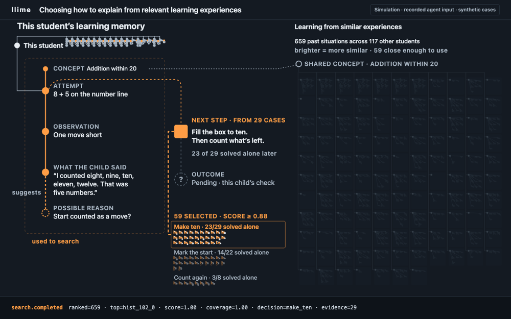
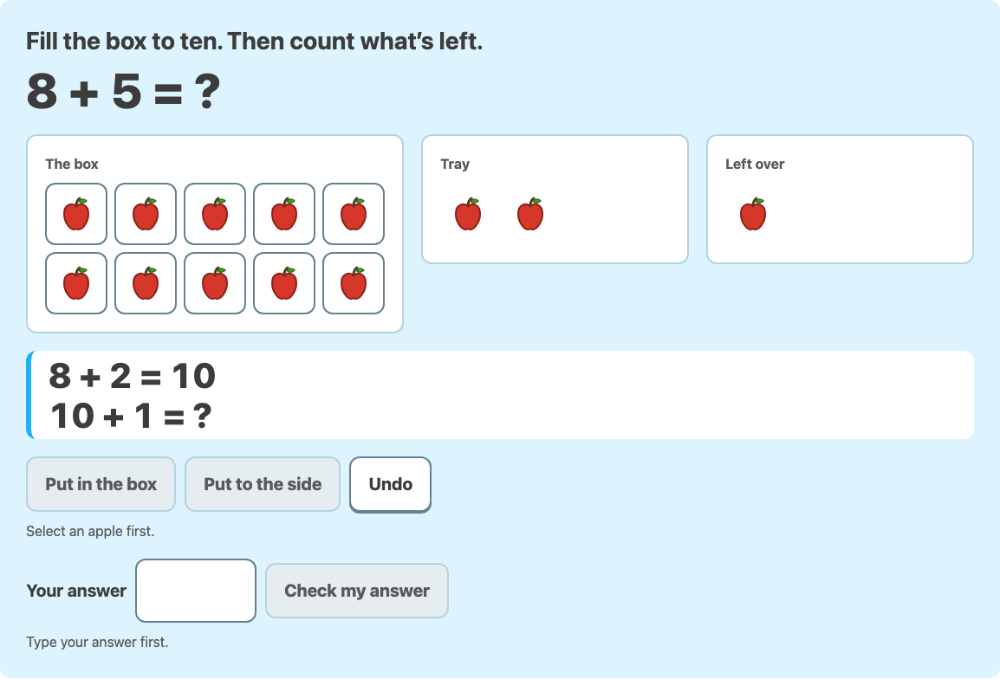
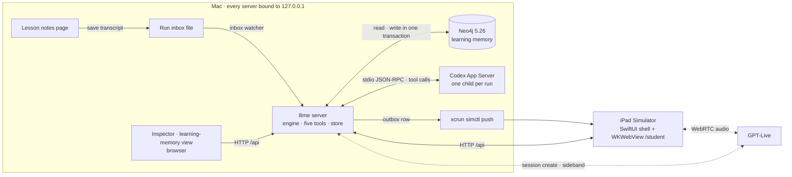
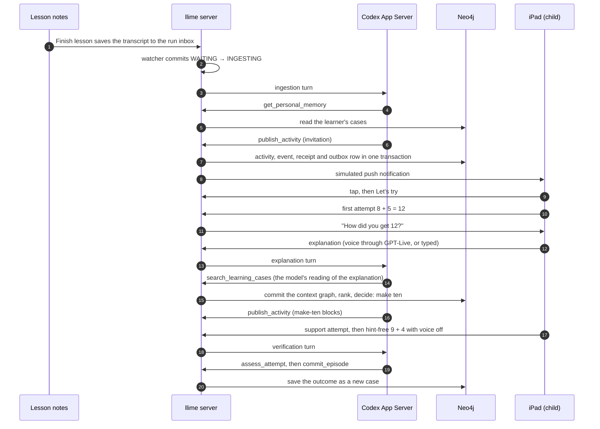
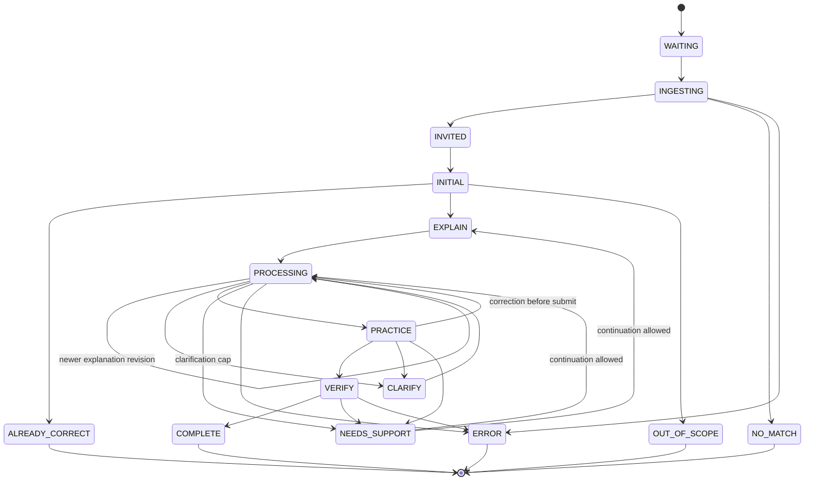
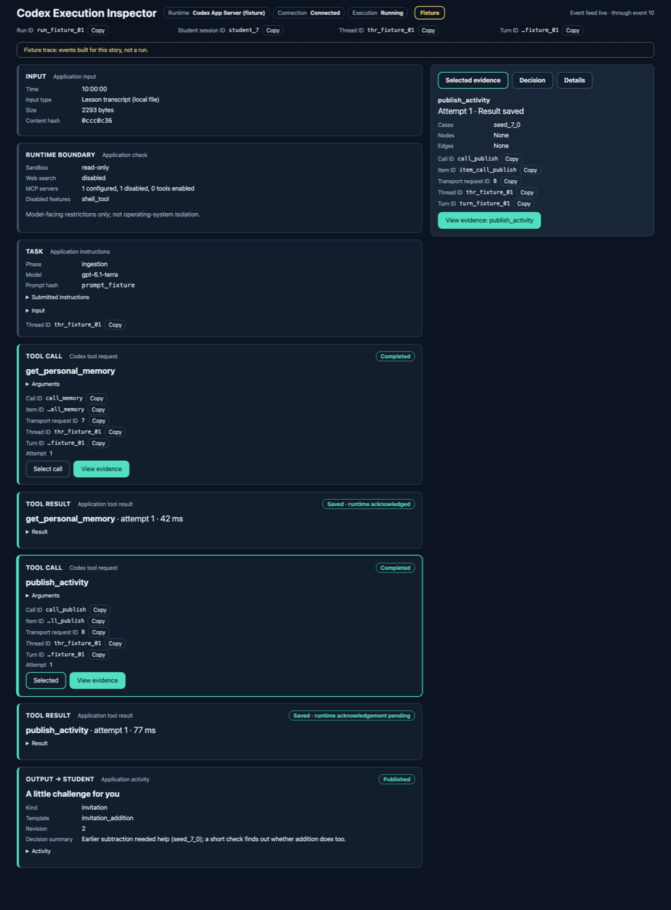

# llime

llime (pronounced "lime"): **education that remembers each learner and takes initiative.**

**Watch the 90-second demo:** [youtu.be/zifdJcFao8g](https://youtu.be/zifdJcFao8g)

## The problem

Great education needs continuing personal attention. Teachers and tutors have limited time between lessons. Learners must often decide when and how to ask for support.

In a 2021 California study, only **19%** of control-group students used free tutoring on request. The study covered middle and high school students, not our first elementary-school users. Access alone did not ensure use ([published 2025](https://doi.org/10.3102/0013189X251331518)).

We are building llime, an education agent that uses personal learning memory to offer a next step. This memory records past attempts, explanations, support and results. The learner can accept or decline each invitation. This is our take on [YC's request for The Primer](https://www.ycombinator.com/rfs/).

## What llime does

The demo follows four steps.

1. **Connects today's lesson to the child's history.** The demo learner has 18 earlier subtraction cases and no addition cases. Today's lesson is addition. Through the curriculum link between subtraction and addition, llime offers a short challenge on the iPad:
   > Remember taking things away in subtraction? Today, let’s put things together with addition. Want to try?

   The child chooses **Let’s try** or **Later**. Nothing starts until the child accepts.

   
   <sub>A real OS notification on the iPad Simulator, sent by the server after the invitation was committed.</sub>

   
   <sub>The invitation in the iPad shell, opened from a notification tap (the shell's toolbar is cropped).</sub>

2. **Asks how, not just what.** The child jumps along a number line from 8 and answers 12 instead of 13. llime asks *"How did you get 12?"* The child explains aloud, or types. An account like "I started at eight and counted eight, nine, ten, eleven, twelve" supports the hypothesis that the child counted the starting number as a move.

   
   <sub>The number line with the film problem, rendered in a browser test, not taken from a live run.</sub>

3. **Uses comparable situations to choose how to explain.** llime searches other learners' recorded situations with a similar structure of actions and explanations, then compares the support they got and the independent results that followed. In the synthetic data, a ten-box ("make ten") activity leads. Codex composes the activity from validated components, so the child works with the same idea in a different form. The histories are authored to demonstrate the mechanism, not to show that one teaching method works better.

   
   <sub>Live run (Codex App Server and Neo4j over the synthetic history): other learners' memories on today's concept, before the search.</sub>

   
   <sub>The search and decision, replayed from a recorded agent input over the synthetic cases (the view labels itself "Simulation").</sub>

4. **Checks a fresh attempt, then saves the evidence.** The child moves objects into a ten-box (8 + 5 becomes 10 + 3), then solves a fresh 9 + 4 with no hints and no microphone. The attempt, the explanation and the independent result are saved to the learner's memory graph. Reusing that saved case in a later session is future work.

   
   <sub>The make-ten support activity mid-move, rendered in a browser test, not taken from a live run.</sub>

## Who it is for

Our first users are students in grades 2–3 who need help with math homework. Parents are the proposed buyers. We have not tested demand or a subscription price.

Our goal is support across lessons, subjects and years. Arithmetic is the first demonstration. Teachers remain part of the learner's education.

## Demo status

- **Real execution:** nothing in the flow is scripted or hardcoded. Proven on a clean clone: the lesson save reaches the inbox watcher, a real Codex App Server turn calls the memory tool and publishes the invitation, and a real voice session opens and closes. A complete QA main run with the film seed went from the saved lesson to the hint-free 9 + 4 (no helpers), committed its outcome once and reached COMPLETE; its export's hashes verified. A fresh run at the freeze commit reached COMPLETE; its export hashes verified and its ranking hash matched the search event. Spoken explanations work in a desktop browser. The iOS Simulator cannot capture speech, so the film's explanation is typed and labelled as typed. Storybook stories and recorded fixtures are never used as evidence. Open items are listed in [docs/engineering-qa.md](docs/engineering-qa.md): accessibility checks are waived for this release.
- **Scripted:** the film uses problem seed 28, which gives 8 + 5 and then 9 + 4 (other seeds give other pairs). An adult plays the child and makes the planned mistake. The outcome rates in memory were written by us to show the mechanism.
- **Synthetic:** the lesson transcript and every learner history. Start and Stop recording on the Lesson notes screen stage the prepared transcript; no classroom audio is captured or transcribed. Finish lesson saves the transcript for real, and that saved file is what triggers processing. The memory holds 781 situations from 120 fictional learners.
- **Simulated:** the iPad runs in the iOS Simulator, and the notification is a simulated push.
- **Not shown:** real learning gains, long-term retention, a saved case being reused in a later session, or any real child data.
- **Not built:** a teacher view. The Lesson notes screen only saves the lesson transcript.
- **Engineering checks** outside the film are listed in [docs/engineering-qa.md](docs/engineering-qa.md).

## How it works



The main path, from the lesson to the saved result:



Each run moves through fixed phases ([`PHASE_TRANSITIONS`](src/domain.ts)):



The model interprets; deterministic tools decide and write. Five tools search memory, compare situations, publish the activity, check the attempt and save the episode. The search compares the *structure* of situations (for example, a move trace one short of the answer followed by an explanation that counts the start) and never the child's words or the past outcome. Everything runs on one Mac, bound to `127.0.0.1`; model inference and voice are external services.

For the recorded film query, the search compares 659 other learners' cases on the same concept and admits 59 close matches. Among them, make-ten support has 23 independent successes in 29 assessed cases, marking the start 14 in 22, and repeating the count 3 in 8. Repeating the count has no activity template, so it can never be chosen. These numbers are recomputed from the seed by the build's own search code in [`tests/search-film.test.ts`](tests/search-film.test.ts). A live run depends on how the model reads the child's explanation: one live QA run ranked the same 659 cases and admitted 51. These are authored synthetic outcomes that drive a deterministic choice, not causal evidence about teaching methods.

Every tool call is visible in the inspector:


<sub>The inspector with a story fixture, labelled "Fixture" in the view; it is not a recording of a run.</sub>

Memory and guiding questions are not unique to llime. Our design connects lesson context, personal memory, agent initiative and activities in one workflow. We still need to test its advantage over other approaches.

Details: [docs/architecture.md](docs/architecture.md).

## Run it

**Requirements:** macOS, Node.js ≥ 22.12, Docker (Docker Desktop or OrbStack), Codex CLI 0.166.0 signed in (`codex login`), an OpenAI API key for voice, and Xcode with the iOS 26.5 Simulator runtime for the iPad app.

The provider key is read from `~/.config/llime/provider.env` (a single `OPENAI_API_KEY=...` line, file mode 0600). The setup script copies it into the gitignored `.env` without printing it. Codex uses its own sign-in, and neither the key nor the database password is passed to it.

```sh
git clone https://github.com/victor0225/LLiMe.git && cd LLiMe
npm ci
node scripts/setup-env.mjs --init-machine   # once per computer: creates the local database credential
npm run setup:env                           # writes .env (0600) from the machine credential and key
npm run db:up                               # Neo4j 5.26 on 127.0.0.1:17474 / 17687
npm run doctor                              # checks Node, Docker, Neo4j, Codex, key, ports, data, Simulator
npm run dataset                             # checks the data files against their manifest
npm run seed                                # verifies the seed hash, loads 781 cases from 120 learners
npm run typecheck && npm test
```

Start the app and create a run:

```sh
npm run dev                                 # http://127.0.0.1:4317
npm run demo:reset -- --case main           # prints the new RUN_ID (film seed unless --seed N)
```

Open `http://127.0.0.1:4317/lesson-notes?runId=RUN_ID` and press Start recording, Stop recording, then Finish lesson. Or, from a terminal, `npm run demo:drop -- --run RUN_ID` writes the same prepared transcript into the run's inbox. Either way, the inbox watcher starts ingestion.

| Page | What it shows |
| --- | --- |
| `/student?runId=RUN_ID` | The child's app: invitation, number line, explanation, activity, independent check |
| `/inspector?runId=RUN_ID` | Every tool call with its arguments, result and timing |
| `/backend?runId=RUN_ID` | The learning-memory search and the decision |

**iPad app:** build and install the Simulator shell as described in [ios/README.md](ios/README.md), and launch it with `-LLIME_ORIGIN http://127.0.0.1:4317`, the server's address. To receive the simulated notification, set `SIMULATOR_UDID` in `.env` to the booted device's UDID before starting the server.

**Recording and evidence:**

```sh
npm run build && npm run start              # serves the built app from dist/
npm run demo:export -- --run RUN_ID         # read-only capture under .runtime/captures/
npm run demo:replay -- --capture CAPTURE_ID # opens a capture read-only
npm run live:voice                          # opens and closes one voice session as a check
```

**Stop and clean up:** Ctrl-C stops `dev` or `start`. With the server stopped, `npm run demo:purge -- --run RUN_ID` deletes that one run's data and nothing else. The database keeps running and keeps its volume.

A clean `https` clone ran this sequence, from `npm ci` through `demo:purge` and `npm run build-storybook`, and every step exited 0. It ran on a build Mac that already had the database credential, the running Neo4j service, Docker images and npm caches, so it is not a bare-machine install: `--init-machine`, a cold first start of Neo4j and the Simulator steps were not exercised, and `demo:replay` was not part of it. On npm 11, `npm ci` warns that the esbuild and fsevents install scripts are not allowlisted; build and tests are unaffected.

## What we still need to learn

- Whether this improves independent and delayed performance compared with simpler tutors.
- Whether invitations feel timely rather than disruptive.
- Whether other learners' outcomes add value beyond the child's own record.
- Whether choosing help from past choices narrows what gets tried. The current rule does not explore, and past outcomes reflect earlier choices, not proof of what works.
- Whether parents come back and pay.

## Team

**Team Zook**

- **Sunho Kim:** Denison University; software engineer at Wondermove; founder of FlowSpace ([myflowspace.app](https://myflowspace.app))
- **Suhyun Cho:** Tech University of Korea

## Data and license

**Data:** the learner cases and lesson transcript are authored synthetic data. Each ships with a manifest and SHA-256 hash ([`data/seed/manifest.json`](data/seed/manifest.json), [`data/lesson/manifest.json`](data/lesson/manifest.json)) that `npm run seed` and `npm run doctor` check.

**License:** no license yet.

**Product and pitch review.** We used [gstack](https://github.com/garrytan/gstack)'s Office Hours diagnostic and CEO review questions to challenge the product framing, compare one-liners and review the 90-second demo with an independent AI reviewer. This shaped planning and presentation. It is not a runtime dependency, an official YC evaluation or evidence of customer demand.
