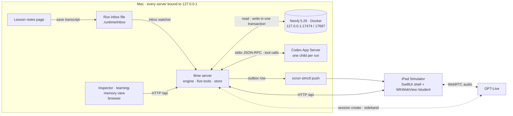

# llime architecture

llime runs on one Mac. A local Node server owns every learning-state change. Codex reads the lesson and the child's explanation and asks for tools. Deterministic handlers answer those tool calls. All learning data in this repository is **synthetic**.

## Topology



| Part | Where | What it does |
| --- | --- | --- |
| llime server | `src/server.ts`, `src/engine.ts`, `src/store.ts` | HTTP API from one route table (`src/routes.ts`), run state machine, transactions, event log, static or Vite-proxied web app. Binds to `127.0.0.1` (`src/config.ts`). |
| Neo4j | `compose.yaml` | One local Community service per computer, loopback ports only, persistent volume. Holds the seed memory, runs, events, receipts, activities and outbox rows. |
| Codex App Server | `src/codex.ts` | One long-lived `codex app-server` child per run, pinned to CLI 0.166.0. The five llime tools are registered as dynamic tools. Built-in shell, file, web and plugin capabilities are switched off, and an item of those kinds fails the turn. The child's environment is an allowlist, so the provider key and the database password never reach it. |
| GPT-Live | `src/voice.ts`, `web/voice.ts` | One voice session per run over WebRTC. The server creates the session with the key, so the browser only sees a session ID and an SDP answer. The server attaches a sideband observer to the same session. Audio stays gated until the sideband is attached and the session has started. |
| iPad shell | `ios/` | SwiftUI app hosting `/student` in a `WKWebView`. It owns notification permission and opens tapped notifications. It contains no learning logic. See [ios/README.md](../ios/README.md). |
| Notifications | `src/notify.ts` | One committed outbox row becomes one simulated push to the configured Simulator (`SIMULATOR_UDID`). The push runs after the commit and cannot change the activity. |
| Web surfaces | `web/` | `/lesson-notes` (saves the lesson transcript), `/student` (the child's app), `/inspector` (tool calls), `/backend` (memory search and decision). There is no teacher view. |

## Run lifecycle

A run is one learner's session. Its phases and allowed transitions are fixed in `src/domain.ts` (`PHASE_TRANSITIONS`):

```text
WAITING → INGESTING → INVITED → INITIAL → EXPLAIN → PROCESSING ⇄ CLARIFY
                    ↘ NO_MATCH          ↘ ALREADY_CORRECT        ↓
                                                              PRACTICE → VERIFY → COMPLETE
                                                                            ↘ NEEDS_SUPPORT
```

1. **Lesson save.** Finish lesson on `/lesson-notes` writes the transcript into the run's inbox file. Start and Stop recording only stage the prepared synthetic transcript; no audio is captured. The inbox watcher (`src/inbox.ts`) waits until the file is complete and stable, commits `WAITING → INGESTING`, then starts one ingestion turn. Nothing else starts ingestion, and the student app has no Analyze button.
2. **Invitation.** Codex reads the lesson, calls `get_personal_memory`, and publishes the invitation with `publish_activity`. The handler checks that every quote appears in the transcript and every evidence ID was returned in this run. The invitation text is fixed copy from `src/copy.ts`; the model chooses whether to invite, not the words.
3. **First attempt.** The child accepts, then solves the selected problem on a number line. A correct answer ends in `ALREADY_CORRECT` with no teaching forced. A wrong answer moves to `EXPLAIN`, and the app asks "How did you get N?".
4. **Explanation.** The child speaks or types. Codex proposes a graph of the explanation and calls `search_learning_cases`, then publishes the chosen activity.
5. **Practice and check.** The child works the support activity, then a fresh problem with no hints and no voice. `assess_attempt` returns the saved assessment and `commit_episode` writes the outcome.

Clarification is capped at three rounds (`MAX_CLARIFICATION_ROUNDS`, `src/engine.ts`), and a run may receive at most two interventions (`MAX_INTERVENTIONS`). Past either cap the run ends in `NEEDS_SUPPORT` instead of looping.

**Problem selection.** A run's problem pair comes from its seed (`src/problems.ts`). The film seed, 28, gives 8 + 5 for practice and 9 + 4 for the independent check. Other seeds give other valid pairs, and none of them repeats a problem from the lesson. `publish_activity` rejects an activity whose numbers differ from the run's pair.

## The five tools

The model proposes; the handlers decide and write (`src/tools.ts`). Every tool input and output is a zod schema in `src/domain.ts`.

| Tool | Reads or writes | What it does |
| --- | --- | --- |
| `get_personal_memory` | read | Returns the learner's own cases for one or two concepts, newest first and at most 8 per concept (`MAX_MEMORY_CASES_PER_CONCEPT`), with a summary that counts all of them. The demo learner has 18 subtraction cases and no addition cases; the summary counts 18, and 8 are returned. |
| `search_learning_cases` | write, then read | Validates the model's interpretation of the explanation (allowed node and edge types, quotes that exist in the stored source), commits it as the context graph, then runs the search and the decision rule on that committed graph. |
| `publish_activity` | write | Publishes exactly the activity the decision chose: same template, strategy, problem and evidence. A mismatch is `VALIDATION_FAILED`. The activity, its event, the idempotency receipt and any notification outbox row commit in one transaction. |
| `assess_attempt` | read | Returns the assessment the server computed when the attempt was submitted, using the activity's own rubric (`src/assessment.ts`). Hints or an invalid move trace cannot earn an independent pass. |
| `commit_episode` | write | Builds the outcome from stored attempts and assessments, never from model text, and saves the episode as a new case with result nodes. Retention stays `pending`. |

Every write is keyed for idempotency. A repeated request with the same payload returns the original receipt; a changed payload with the same key is a conflict.

## Retrieval: typed-path-v1

`src/search.ts` holds retrieval and the decision rule as pure functions, shared by the server and the browser views.

**Case graphs.** A case is a small typed graph: nodes such as `Attempt`, `Observation`, `Explanation`, `Hypothesis`, `Question` and `Retry`, joined by edges such as `OBSERVED`, `EXPLAINED_BY` and `SUPPORTS`. Each node has a meaning, for example `Observation:one_move_short` or `Hypothesis:count_start`. Result nodes (`Intervention`, `Outcome`) record what was done and what happened. They never take part in similarity.

**Paths.** For each context-stage node, the search walks directed paths of one to three edges. A path's key is its sequence of labels, such as `Attempt:addition → OBSERVED → Observation:one_move_short`. IDs, text and layout never enter a key.

**Scoring.** For a query `q` and a candidate `c`, matching keys are counted as multisets and each path is weighted by its edge count:

```text
score    = Σ w·min(q,c) / Σ w·max(q,c)     how alike the two cases are
coverage = Σ w·min(q,c) / Σ w·q            how much of the query the candidate explains
```

**Candidates.** Only other learners' cases on the same concept, recorded no later than the query. Strategy and outcome travel with each candidate for the decision but never affect its score. Ties break on case ID, so the same input always gives the same ranking. A SHA-256 ranking hash over the ordered IDs, scores and coverages identifies each ranking.

**Admission.** A case is admitted only if the best match scores at least 0.45, the case scores at least `max(0.45, best − 0.12)`, it covers at least 0.6 of the query, and it has an assessed outcome. These thresholds are uncalibrated demo policy; structural overlap is not a probability of success.

## The decision rule

`chooseActivity` (`src/search.ts`) applies four layers in order:

1. **Clarify.** If the model flagged the explanation as unclear, if more or fewer than one hypothesis is active, or if that hypothesis is `unknown` or `novel`, llime asks instead of teaching. It asks what was counted first when every active hypothesis is `count_start` or `slip`; otherwise it asks the child to show their steps.
2. **Slip policy.** A lone `slip` gets a fair retry. This is application policy, not something learned from other children.
3. **Evidence.** Admitted cases are grouped by strategy and ranked by a smoothed independent rate, `(independent + 1) / (total + 2)`. Only strategies that have an activity template and are allowed for the hypothesis compete (`count_start`: make ten or anchor the start; `partition_gap`: make ten). The leader is chosen if it has at least one independent success.
4. **Default.** With no usable evidence, `count_start` gets anchor-the-start and `partition_gap` gets make-ten. Any other hypothesis clarifies.

**Novel hypotheses always clarify.** When the model's reading of an explanation fits none of the five known meanings, it proposes `novel` with a short `proposedMeaning`. A lone novel hypothesis clarifies with the novel reason however high the scores are, and a novel hypothesis mixed with others fails the one-known-hypothesis check. The proposed name appears only in the inspector and the graph view, as "Possible new pattern: …", never on the child's screen or in speech.

**The film query.** The search compares 659 candidate cases, admits 59, and groups them as make-ten 23/29, anchor-start 14/22 and repeat-count 3/8. `count_start` allows make-ten and anchor-start; make-ten leads and is chosen with basis `evidence`. Repeat-count has no template and can never be chosen. `tests/search-film.test.ts` recomputes all of this from the seed and checks it against the recorded ranking.

## Persistence and events

- **One transaction per state change.** The domain write, its events and its idempotency receipt commit together in Neo4j (`src/store.ts`). Events are published only after the commit.
- **Ordered event log.** Each run has a sequence of typed events (`src/events.ts`): lesson detected, tool started and completed, memory retrieved, graph updated, search completed, activity published, notification queued and sent, outcome committed, and others. The web surfaces poll `GET /api/runs/:runId/events?after=N` and rebuild their view from that log.
- **Restart.** Committed receipts and outcomes survive a restart without duplicate writes. An interrupted, uncommitted step becomes `ERROR`; recovery never reruns model work.
- **Export and replay.** `npm run demo:export` reads a run through the GET routes into an immutable capture with per-file hashes. `npm run demo:replay` serves a capture read-only: every POST is refused, and no database, Codex or voice session is opened.

## Voice

The child can explain aloud on `/student`. The page opens a WebRTC connection; the server creates the GPT-Live session and attaches a sideband observer to it (`src/voice.ts`). When the child finishes, the engine writes the explanation, its voice operation and a delegation event in one transaction, then hands the explanation to Codex. A later correction creates a new explanation revision and steers the running turn; an older revision can no longer publish. The microphone and voice output are torn down before the independent check is enabled. Typing is always available instead of speaking.

## Data

| File | Contents |
| --- | --- |
| `data/seed/cases.json` | 781 authored synthetic cases from 120 fictional learners (seed version 7). Outcome rates were written to show the mechanism. They are not real student outcomes. |
| `data/seed/concept-links.json` | Three curriculum links: each leaf (`addition_within_20`, `subtraction_within_20`) is a subconcept of its parent, and the parents `addition` and `subtraction` are similar. |
| `data/seed/manifest.json` | Counts and SHA-256 hashes. `npm run seed` refuses to load data that does not match. |
| `data/lesson/lesson-transcript.txt` | A 27-turn authored lesson on addition within 20. No audio was recorded or transcribed. Its manifest pins the hash. |
| `data/captures/` | Recorded fixtures used by stories and tests, labelled as recorded. They are not evidence of a live run. |

`npm run dataset` checks the corpus against its manifest without changing the files. `npm run seed` loads it idempotently: a second run writes nothing.

## Trust boundaries

- Every model tool argument, HTTP body, file read and environment variable is parsed by a schema before use.
- The provider key lives only in the server process. Codex, `simctl` and other child processes get allowlisted environments.
- Lesson and child text is passed to Codex as escaped JSON data inside the turn instructions. Instruction-like text in a transcript cannot add tools or capabilities. The voice model is guided by its instructions, not constrained by code; QA checks that it treats such text as learner data (V12 in [engineering QA](engineering-qa.md)).
- Prompt inputs are scanned so that test expectations or run labels never reach the model.
- The iPad shell loads one loopback origin and navigates only within it.
